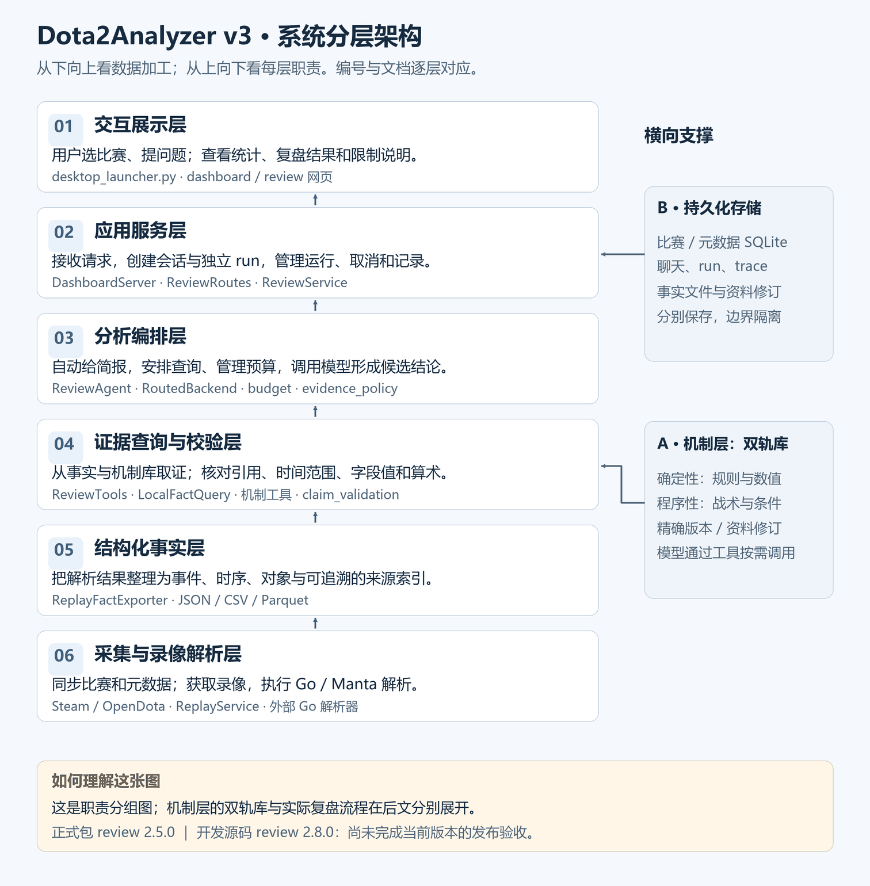
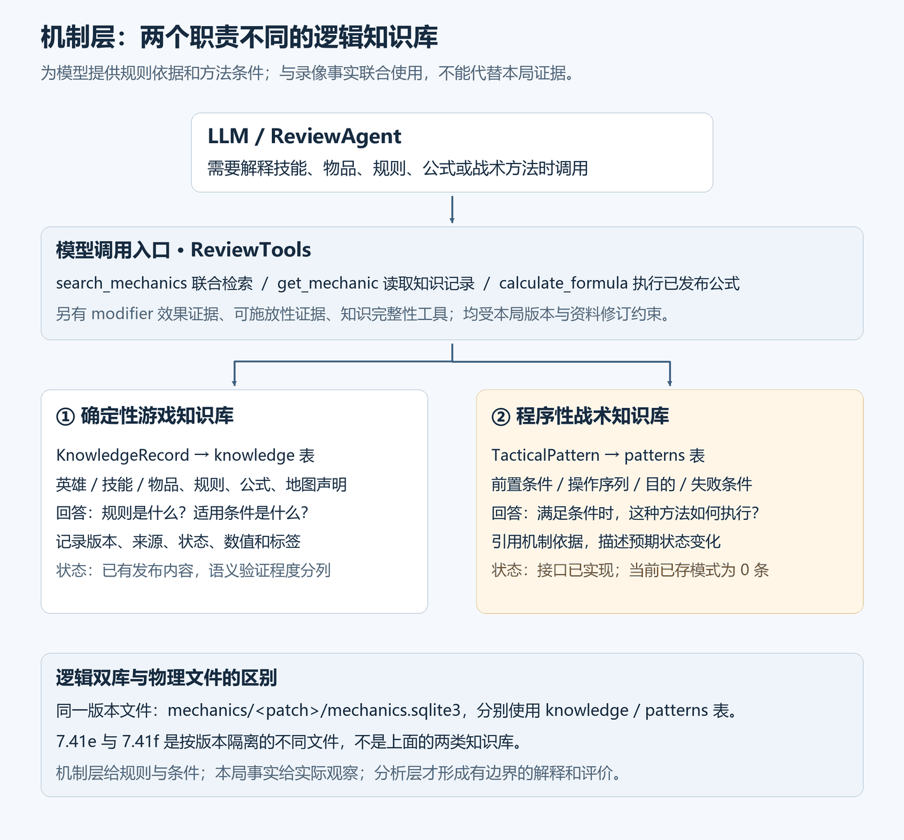
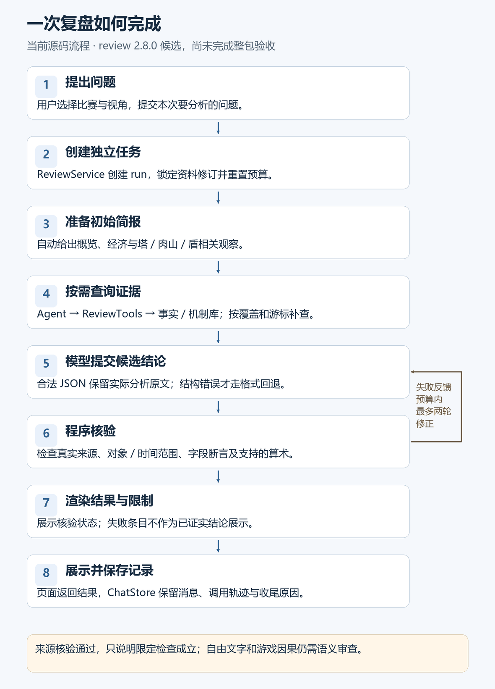

# Dota2Analyzer v3：系统架构与功能实现状态

**核查日期：2026-11-03。** 本文说明本地系统由哪些部分组成、每层负责什么，以及哪些能力已经可用、哪些仍在开发。历史测试和真实复盘证据主要形成于 2026-10-09，不能把本文更新日期当作重新测试日期。

系统有两条主线：**把比赛与录像加工成可查事实**；**让模型根据这些事实回答复盘问题，并核对结论来源**。整体链路已经建立，复杂复盘的语义可靠性仍未完成验收。

本仓库公开文档及配图；源码、密钥、个人数据库、录像和模型原始对话未随文上传。

## 一、系统全景：六层结构与两类横向支撑



**读图方法：** 从下往上看“数据如何变成分析结果”；从上往下看“用户看到的功能由谁负责”。这是职责分组图，机制层在第二节单独展开，具体调用顺序见第四节流程图。

| 图中层号 | 每层的核心问题 | 输入 | 输出 |
|---|---|---|---|
| 01 交互展示 | 用户如何操作、看到什么？ | 用户选择、问题、运行状态与结果 | 仪表盘、复盘页面、统计及限制说明 |
| 02 应用服务 | 谁接收请求、管理一次任务？ | 网页请求、比赛和会话标识 | 独立分析任务、运行/取消状态、结果接口 |
| 03 分析编排 | 该查什么、何时停止、如何组织回答？ | 问题、初始简报、工具返回证据 | 查询计划、候选结论与证据缺口 |
| 04 证据查询与校验 | 如何取到证据，如何核对引用？ | 时间窗、玩家、数据流、来源定位及结论 | 有来源的事实包、覆盖/分页信息、校验结果 |
| 05 结构化事实 | 如何让原始解析结果可查？ | 比赛记录、录像解析输出 | 事件、时序、对象、能力声明与真实来源索引 |
| 06 采集与录像解析 | 原始资料从哪里来？ | 外部比赛接口、元数据、录像 | 原始比赛数据、元数据和录像解析结果 |

### 01 · 交互展示层：把系统能力交给用户使用

负责比赛列表、统计仪表盘和复盘对话界面。用户在这里选择比赛、输入问题、查看分析进度与结论。

- **对应实现：** `desktop_launcher.py`、仪表盘导出页面、`web/review.html`、`review.js`、`review.css`。
- **与下一层的关系：** 页面向本地服务发送请求，由服务返回数据和状态；页面本身不直接解析录像或执行模型取证。
- **实现状态：** 桌面入口和本地网页已建立。当前是本地应用形态，尚非多人云端服务。

### 02 · 应用服务层：管理会话和每次分析任务

接收界面请求，把“这次用户提问”转换为一个独立的 `run`。它负责会话、任务启动、取消、状态返回和运行记录协调。

- **对应实现：** `server/dashboard_server.py` 的 `DashboardServer`，`review_routes.py`，`review/service.py` 的 `ReviewService`。
- **任务边界：** 新问题建立新 run，预算按单次问题重置，不累计整个聊天的历史开销。会话固定游戏资料版本和修订。
- **实现状态：** 已接入本地服务。底层使用 Python `ThreadingHTTPServer`，前端为静态网页资源。

### 03 · 分析编排层：安排取证并调用模型

这一层组织复盘过程：先给模型比赛简报，再根据问题安排查询、读取覆盖与分页状态，最后生成带引用的候选结论。

- **对应实现：** `review/agent.py`、`routing.py`、`budget.py`、`evidence_policy.py`、`initial_briefing.py`。
- **输入与输出：** 输入是用户问题和工具事实；输出是查询请求、候选解释及尚未覆盖的问题。模型先前生成的分析不被当成新事实。
- **模型分工：** 路由角色选择处理路径；专家角色执行分析。当前公共配置中两者都指向 `deepseek_v41_flash`，已完成的真实回归响应使用 `deepseek-flash`。
- **实现状态：** 正式包仍为 review 2.5.0；当前源码已改到 2.8.0 候选，后者尚未完成整包验收和发布。

### 04 · 证据查询与校验层：取事实，查引用

这层有两个方向的工作：分析前按范围返回证据；分析后核对模型提交的结论是否引用了真实、匹配的记录。

- **取证模块：** `ReviewTools`、`LocalFactQuery`、`match_summary.py`、`hero_lifecycle.py`、`combat_evidence.py`。
- **查询能力：** 全局摘要、时间窗口、玩家索引、战斗簇、死亡切片、买活、盾相关观察，以及指定来源行的字段读取。
- **校验模块：** `claim_validation.py`、`review/final_answer.py`。核对来源存在、对象和时间范围、字段断言、支持的时序与算术。
- **来源定位：** 原生 event/sample ID、一基物理数据行、JSON Pointer；过滤和分页不能把结果重新编号后冒充原文件行号。
- **实现边界：** 来源和范围通过，只能说明限定检查成立，不能自动证明自由文字的含义、长期外推或游戏因果。

### 05 · 结构化事实层：把解析输出变成可追溯资料

把录像解析结果整理成统一的数据文件和对象，供第四层查询。高频时序、大型事件流与紧凑索引使用不同载体，避免每次把整个录像塞给模型。

| 载体 | 保存什么 | 用来回答什么 |
|---|---|---|
| `metadata.json` | 比赛时长、解析版本、能力等元信息 | 本局数据范围是什么、支持哪些能力？ |
| `replay_compact.json` | 紧凑事件及原生数组 | 肉山、盾取得、买活等记录在哪里？ |
| CSV | 玩家终局统计、计分事件、目标、技能或物品事件 | 某条事件或终局统计的原始字段是什么？ |
| Parquet | 经济、位置、英雄状态、库存和原始回调等时序 | 某时段状态如何、采样是否完整？ |
| `combat_fact_objects.json` | 战斗簇、死亡切片等派生对象 | 应先深入哪些窗口？ |

- **对应实现：** `replay/fact_exporter.py` 及 `replay/` 下各类事实转换模块。
- **身份约束：** 英雄/物品实体使用 index 与 serial 联合绑定，降低克隆、实体复用或旧快照错误归属的风险。
- **实现边界：** 正式计分死亡、原始死亡回调、库存变化、推导关联分别保存；时间邻近不直接升级为耗盾或复活完成。

### 06 · 采集与录像解析层：取得并解码原始资料

从 Steam/OpenDota 等接口同步比赛，通过 Valve 元数据补充英雄和物品信息，并调用外部 Go 解析器处理录像。

- **对应实现：** `api/`、`collector/`、`metadata/`、`replay/downloader.py`、`parser_backend.py`、`service.py`。
- **解析器：** `tools/replay_parser_source/` 的 Go/Manta 实现；当前保留本地 third-party 替换及 `fixed8` 解码修复。
- **实现状态：** 采集、增量更新、解析集成与导出均有实际实现及历史运行证据；旧事实保留，不假定旧录像拥有后来新增的全部字段。

## 二、机制层：模型按需调用的双轨知识库

机制层是模型复盘时的重要取用内容：事实层说明“本局观察到了什么”，机制层说明“规则是什么、在什么条件下可以怎样做”，分析层再把两者结合成有边界的解释和评价。



### 1. 两类库为什么必须区分？

| 对比 | 确定性游戏知识库 | 程序性战术知识库 |
|---|---|---|
| 代码类型 | `KnowledgeRecord` | `TacticalPattern` |
| SQLite 逻辑表 | `knowledge` | `patterns` |
| 主要内容 | 英雄、技能、装备、天赋、命石、modifier、规则、公式和地图资料等版本化知识记录 | 问题、前置条件、操作序列、机制依据、预期状态变化、目的、失败条件 |
| 回答的问题 | “规则和数值是什么？有什么条件或例外？” | “在这些条件下，这种处理方法如何执行、何时会失败？” |
| 如何参与分析 | 解释技能/物品/状态，为受支持计算和规则检查提供依据 | 提供可复用的方法与条件，供模型结合本局事实判断是否适用 |
| 不负责的事情 | 不凭目录存在证明本局已学习、已持有、已生效或已触发 | 不直接把方法模板变成本局“应该这样打”或“打得好坏”的定论 |
| 当前内容状态 | 已有实际发布记录，身份/配置/来源声明/已验证规则等状态须分别读取 | 数据类型、存储与检索接口已实现；现场两个版本的 `patterns` 表均为 **0 条** |

“确定性”是知识类型和规则组织方式，不能据此宣称其中每条文本都已得到运行时认证。“程序性”描述做事的方法和成立条件，不是录像事件库，也不是让 LLM 凭经验自由补写战术。

### 2. 逻辑双库如何落盘？

当前实现是**同一个版本 SQLite 文件内的两张职责不同的表**，不是强行拆成两个物理文件：

```text
mechanics/
  7.41e/mechanics.sqlite3
    knowledge   确定性知识记录：按 patch + revision + kind + id 定位
    patterns    程序性战术模式：按 patch + revision + id 定位
    releases    发布版本与来源
  7.41f/mechanics.sqlite3
    knowledge / patterns / releases 等同类结构
```

`7.41e` 与 `7.41f` 是按游戏版本隔离的文件，和“确定性库 / 程序性库”这组逻辑分工是两回事。根目录的旧 `data/mechanics.sqlite3` 保留兼容入口，现场其内容为空；它不是另一套已经填好的战术库。英雄/物品名称用的 `dota2_metadata.sqlite3` 也另有职责，不替代机制双库。

现场只读核对的最新资料修订：

| 游戏版本 | 资料修订 | `knowledge` 记录数 | `patterns` 记录数 |
|---|---|---:|---:|
| 7.41e | `r7-declarations-08d4370c4ce9` | 6,860 | 0 |
| 7.41f | `r3-declarations-adae7d862ebd` | 5,454 | 0 |

数字只代表该修订已保存的记录，不能当作认证规则数；两个版本的内容也不同。例如现存 7.41e 最新修订有受支持公式、公式缺口和部分规则，7.41f 最新修订没有这些同类记录，不能跨版本直接套用。

### 3. 模型通过哪些工具使用机制层？

模型通过 `ReviewTools` 调用，而不直接访问或修改 SQLite。`VersionedKnowledgeCatalog` 与 `SqliteKnowledgeCatalog` 按会话固定的版本和修订解析资料。

| 模型工具 | 实际作用与返回边界 |
|---|---|
| `search_mechanics` | 在精确修订内搜索知识记录和战术模式；底层查询联合检索 `knowledge`、`patterns`。搜索结果可能是摘要，完整知识记录需继续读取 |
| `get_mechanic` | 按 `kind` 和 `record_id` 读取确定性知识记录，查看结构化值、来源、状态和条件 |
| `calculate_formula` | 读取本修订已发布公式，校验输入名称、单位与范围后计算；没有对应公式时拒绝回退或编造 |
| `get_modifier_effect_evidence` | 返回 modifier 的来源声明、观察关联、条件/冲突及未验证边界 |
| `get_castability_evidence` | 将本修订状态规则与指定玩家/时刻的冷却、英雄状态等事实结合，返回可施放性证据及缺口 |
| `get_knowledge_completeness` | 检查精确修订或单条资料的身份、定义、缺失、冲突与有效性边界 |

`get_pattern` 的 Python 目录接口已存在，但当前模型工具表没有独立的 `get_tactical_pattern` 工具；战术模式的模型检索入口是联合搜索，且目前没有已填充模式可供实际检索。这一点与“战术库已经可用且内容丰富”有明确区别。

### 4. 机制层怎样与本局事实结合？

以“这个时刻是否能施放某物品”为例：先读取该物品在会话修订中的状态交互规则，再查本局附近的英雄状态与冷却样本。规则缺失、采样截断或关键状态未知时，返回相应缺口；不能仅凭物品名称推断一定能放。

同样，若未来战术库记录某种控线方法，必须先核对前置条件是否与本局事实一致，再作条件性分析；战术模板不能替代实际位置、视野和事件证据。

### 5. 版本、更新和验证边界

- **精确锁定：** 会话固定 `game_version`、`knowledge_revision`。发布新资料不静默改变旧会话依据。
- **不可变发布：** 保存来源并校验版本；新增修订，不覆盖旧修订。缺少精确版本资料时不自动套用最新版本或其他小版本。
- **分清资料性质：** 身份、配置数值、来源文本、条件规则、经验证的计算口径分别报告。**资料目录齐全不代表已认证本局运行时效果。**
- **检索现状：** 当前使用结构化读取和 SQLite 字面检索；向量接口已预留，但 `vector_status=not_implemented`，embedding/向量后端尚未完成。
- **计算边界：** 已发布窄范围公式与规则不代表 EHP、DPS、爆发窗口、装备边际收益或视野重建等预留模型全部完成。`MechanicModel` 的模型槽位不能冒充现成能力。
- **战术内容缺口：** 程序性库仍需真实资料采集、审核、按版本填充与实局适用性验收。机制层本身不直接输出主观评价。

## 三、持久化存储与外部模型

### 持久化存储：把不同性质的数据分开保存

| 数据 | 保存形式及职责 |
|---|---|
| 比赛历史 | SQLite：原始及处理后比赛，供更新和统计使用 |
| 英雄/物品元数据 | 独立 SQLite：身份、名称、来源和刷新记录 |
| 录像事实 | 按比赛组织的 JSON/CSV/Parquet 文件 |
| 机制资料 | 按版本和修订组织的快照与资料库 |
| 复盘会话与轨迹 | `ChatStore`：用户消息、run、工具 trace、预算及终止原因 |
| 模型连接 | 公共角色配置与私密凭证分离；不放在公开报告目录 |

### 外部模型服务：生成解释，事实仍来自受限工具

`review/llm.py` 和 `routing.py` 连接外部模型。工具只开放当前会话的比赛和资料修订；模型不能请求任意文件路径、执行命令或把先前解释充当新证据。

另有 `review/pipeline.py` 的可注册分析模块接口。里面列出的专项模块槽位只是接口设计，不能据此声称每种专项分析器都已经实现并启用。

## 四、运行流程：用户提问后，系统具体做什么？



图示为**当前 review 2.8.0 开发源码流程**，不是对正式 2.5.0 程序新增能力的发布声明。

以“我方为什么赢得艰难、我发挥如何”为例：

1. **建立任务。** 服务锁定比赛、视角与资料修订，创建独立 run。
2. **给全局入口。** 自动简报提供经济里程碑、塔、肉山、买活及盾相关观察，帮助模型先看全局。
3. **查询关键窗口。** 模型选择少量窗口，工具返回双方位置、状态、死亡顺序、物品/技能及目标证据；缺失、截断和续查游标一并返回。
4. **提出可核查结论。** 模型提交实际来源和范围，区分事实、条件性解释、评价与未知。
5. **检查并反馈。** 程序检查引用、范围、字段值和支持的算术。2.8.0 源码允许预算内最多两轮失败修正；合法 JSON 分析直接校验渲染，避免额外格式响应改写结论。
6. **展示边界。** 通过来源校验的文字仍标明语义未自动认证；失败条目显示失败原因，未覆盖问题保留限制说明。

### 查询预算

| 模式 | 模型响应上限 | 本地查询上限 | 上下文字符阈值 | 单结果字符预算 |
|---|---:|---:|---:|---:|
| quick | 2 | 3 | 65,000 | 12,000 |
| standard | 4 | 6 | 110,000 | 18,000 |
| deep | 15 | 50 | 180,000 | 24,000 |

预算按本次问题计数；查询多不等于查全。`next_cursor`、`truncated`、`partial` 或 `unsupported` 都会限制可作出的结论。

## 五、当前实现到哪一步？

### 版本与验收状态

| 项目 | 现场可确认的状态 |
|---|---|
| 正式程序 | parser `4.23.0-dota2-analyzer-3.21` / fact schema `4.10.0` / review `2.5.0`；现场 EXE 指纹与发布报告一致 |
| 开发源码 | `agent.py` 标记 `review-2.8.0`；包含后续查询、校验和回答流程候选修改 |
| 最近完整候选回归 | review 2.7.1 冻结版：348 项 Python 测试通过，193 个源文件测试前后指纹一致，五个保护库与发布基线一致 |
| 当前源码验证边界 | 已有多个文件晚于该冻结版发生变化；旧 348 项结果不能代表当前 2.8.0 已完整回归 |
| 最近完成的真实复盘 | review 2.7.1：5 个真实模型响应、12 次查询；15 条结论中来源/范围 13 条通过、2 条失败 |
| 该轮整体验收 | **未通过语义验收**；当前 2.8.0 尚无完整的“全量回归 → 真实原题验收 → 整包发布”闭环 |

### 已具备的核心能力

- **比赛数据链路：** 增量采集、本地保存、统计、录像解析及事实导出。
- **可查证据：** 全局摘要、时间窗、战斗簇/死亡切片/买活索引、生命周期观察和真实来源定位。
- **首简报：** 关键塔、肉山和盾观察在首次请求前提供；全量经济采样先计算峰谷与采样符号变化，再做有界投影。
- **身份与方向约束：** 英雄/物品完整身份绑定、天辉减夜魇的明确经济口径、目标归属与攻击者归属分开。
- **结论核验：** 实际来源、对象和时间范围、字段断言及受支持算术检查；错误字段和值可被拒绝。
- **运行可追溯：** 会话、run、真实模型/工具调用、覆盖、预算及终止原因留痕。

### 还在开发或仍有缺口的能力

| 未结事项 | 现在的具体状态 |
|---|---|
| 标准模式证据投影 | 通用 18K 裁剪曾丢失盾相关 raw true 事件正文或续查入口，同时保留引用/可续查声明，导致合同不一致 |
| 专用战斗投影 | `review/context_projection.py` 和测试文件已存在；现场未见 Agent 导入并调用专用投影函数，不能写成主链路已修好 |
| 范围失败反馈 | `claim_validation.py` 已有 `source_scope_failures`，但 Agent 修正提示尚未接入该结构 |
| 首简报攻击者字段 | 索引已新增 actor team/player 和来源映射，但改动晚于最近完整冻结测试，待重新验收 |
| 主动字段核对 | `get_source_rows` 可用，但已观察的真实模型运行未主动调用；仅靠提示词未形成可靠流程 |
| 盾/升级语义 | raw 回调、空槽、实体删除、物品出现等只支持观察或关联候选，不能认证耗盾、失效、完成复活或升级效果生效 |
| 机制/地图语义 | 固定版本来源声明可查，通用 modifier 效果、地图几何/遮挡及部分当前规则仍未全面验证 |
| 自然语言验收 | 稀疏采样外推、个人/团队归因、时间换算和战略因果，尚不能靠来源校验自动解决 |

### 最近真实复盘为什么没有通过？

主要问题集中在解释层：把工具投影没给的字段说成源文件不存在；把队伍拆塔或肉山事件列为个人高光；用终局统计证明长时段稳定；把基地被摧毁的时间外推为提前锁定胜局的时点；还有时间换算和小数边界错误。

部分终局统计、经济节点、个人击杀和盾相关观察可核对，但这些可用事实不足以使整篇复盘通过验收。旧人工审计也曾发生行号误读，已保存勘误，人工意见同样需要回到真实来源复核。

## 六、接下来按什么顺序推进？

1. **先整合已有候选。** 把专用战斗投影和真实范围失败反馈接入实际主链路。
2. **验收证据交付合同。** 在各模式预算内核对事件与引用配对、稀有锚点、游标可调用性、覆盖计数和省略说明。
3. **减少字段和边界猜测。** 让模型方便地读取实际字段和小数时间；保留错误引用、阵营、玩家和范围的拒绝测试。
4. **冻结当前版本并全测。** 保存新的源码指纹与完整回归报告，不沿用 2.7.1 的结果。
5. **再跑真实原题验收。** 逐项检查五问、时间换算、个人/团队归属、盾节点、引用和分页，未知就明确未知。
6. **通过后再打包。** 保留旧程序、解析器、事实和保护库，核对新包版本、自检与实际运行。

## 附录 A：18 项整改清单

<details>
<summary>展开查看逐项状态（主文中的架构和流程不依赖本表）</summary>

“已实现”指该项限定范围有实际代码或历史发布证据，不表示全部游戏语义都已认证。

| 编号 | 项目 | 当前状态与边界 |
|---|---|---|
| 01 | 连续视野直接提取 | 直接字段/变化事件与能力标签已实现；不等于完整视野重建或玩家认知 |
| 02 | 技能命中与 modifier 生命周期 | 原始事件及保守生命周期关联已实现；cast 不等于命中 |
| 03 | 施法状态 | 控制位、冷却、充能、等级、蓝耗和物品观察已实现；通用可施放性仍有条件缺口 |
| 04 | TP 链路 | 目的地、实体与保守完成/取消关联已实现；未知原因和歧义保留 |
| 05 | 伤害与单位归属 | 日志流、身份约束与支持的求和已实现；减伤前后、护盾吸收等语义未全面认证 |
| 06 | 建筑与肉山 | 状态和目标观察已实现；精确刷新、动作原因与 owner 链等仍有缺口 |
| 07 | 逐录像能力覆盖 | 每局版本、能力、缺失原因和重解析建议已实现 |
| 08 | 数学公式 | 版本化执行框架及窄范围公式可用；算术不证明本局规则生效 |
| 09 | 状态与交互 | 保守规则与直接状态位已实现；不按名称猜控制/免疫 |
| 10 | 命石/天赋/A杖/魔晶 | 身份和库存绑定改进；实际有效升级与完整参数修正未结 |
| 11 | modifier 效果映射 | 来源、条件、冲突可查；运行时通用效果未全面认证 |
| 12 | 地图机制 | 固定版本文本可查；几何、遮挡及部分当前规则未验证 |
| 13 | 资料完整性 | 身份、定义、缺失、冲突和显式废弃审计已实现；当前有效性仍需依据 |
| 14 | 完整比赛摘要 | 后台扫描、经济节点、目标索引与首简报已实现；扫描不等于所有原始行都交给模型 |
| 15 | 死亡/复活/目标关联 | 正式死亡、raw 信号、买活和库存候选可查；真实耗盾/复活完成未闭环 |
| 16 | 关键战斗证据包 | 多维覆盖与续查已改进；标准投影及语义链保持未结 |
| 17 | 覆盖驱动预算 | 独立 run 预算、覆盖矩阵和收尾状态已实现；覆盖不等于模型理解正确 |
| 18 | 逐结论校验 | 来源、范围、字段及部分数值可验；自由文字语义和因果未自动认证 |

</details>

## 附录 B：代码入口与核查依据

<details>
<summary>展开查看技术入口与本地证据文件</summary>

代码目录按职责组织：

```text
desktop_launcher.py           桌面入口
dota2_analyzer/
  api/ collector/ metadata/   采集、更新与元数据
  db/                        SQLite 和数据访问
  replay/                    解析器调用、结果集成、事实导出
  analyzer/                  统计、事实查询、生命周期、证据包、校验
    review/                  会话、编排、模型、预算、简报、结论渲染
  mechanics/                 固定来源、版本修订、检索与公式
  server/                    本地仪表盘和复盘接口
  web/ exporter/             页面与报告导出
tools/replay_parser_source/  Go/Manta 录像解析器
```

本地核查依据如下，内部文件未随本文公开：

- `docs/数据层与机制层逐项整改.md`
- `docs/mechanics_analysis_architecture.md`（双轨知识类型定义；早期状态描述须以当前源码与资料核查更新）
- `mechanics/contracts.py`、`storage.py`、`versioned.py`、`retrieval.py`（实际代码位于 `dota2_analyzer/` 下）
- `build/analysis_release_owner_brief_final_20261008.json`
- `build/live_flash_review271_regression_20261009.json`
- `build/live_review_flash_review271_draft_repair_20261009/acceptance_report.json`
- `build/live_semantic_audit_review271_20261009.md`
- `build/live_semantic_audit_review261_errata_20261009.json`
- `build/retrieval_budget_audit_review271_20261009.md`
- `build/initial_briefing_milestones_validation_20261009_v2.json`

正式 EXE 现场 SHA-256：`36b329c983fa4c806c526543a20f5d7bccedf9b00e87a478ffa6cda0d60a7578`。

</details>

**状态口径：有代码 → 已集成 → 已测试 → 真实复盘验收 → 已打包发布，分别判断，不能互相替代。**
